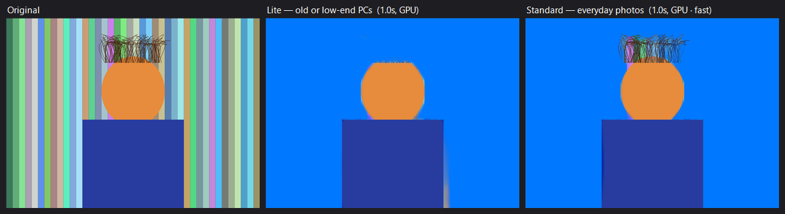

# Konbini

A small Windows desktop toolbox: Image Resizer, Image Compressor, Image Upscaler (AI), Background Remover (AI), File Converter and Video Compressor. Everything runs offline on your own PC.



## Download
Get the latest version from [Releases](https://github.com/xswzaq123/konbini/releases):
- **Konbini-Setup-x.y.z.exe:** an installer that doesn't need administrator rights.
- **Konbini-x.y.z-portable.zip:** extract it and run `Konbini.exe`. It keeps its settings next to the exe.

Konbini needs Windows 10 or 11, and nothing else installed. Larger components (the video engine, and the bigger background-removal models) download the first time you use them, and each one is checked against a fixed SHA-256 hash.

The builds aren't code-signed, so Windows SmartScreen may warn the first time you run one. Click **More info → Run anyway**.

## Build from source
No SDK is needed. The build uses the C# compiler that ships with Windows.

```powershell
powershell -NoProfile -ExecutionPolicy Bypass -File build.ps1     # -> dist\Konbini.exe
```

To make the installer and portable zip, double-click `make-release.bat`. The files go to `dist\release`.

## Project layout
| Folder | Contents |
|---|---|
| `src/` | The app: the shell, each tool, the converters, the AI models and the dependency manager |
| `installer/` | The installer and uninstaller source, the icon and the licence notices |
| `models/` | The small AI models built into the exe; big files here are ignored by git |
| `tests/` | PowerShell test scripts (see `CLAUDE.md` for how to run them) |
| `tools/` | One-off scripts for converting models and making the icon |
| `docs/` | Images used in this README |

## Licences
Konbini is released under the [MIT License](LICENSE). Third-party models and tools are listed in [installer/THIRD-PARTY-NOTICES.txt](installer/THIRD-PARTY-NOTICES.txt). ffmpeg is GPL; Konbini downloads it from its official release rather than shipping it.
